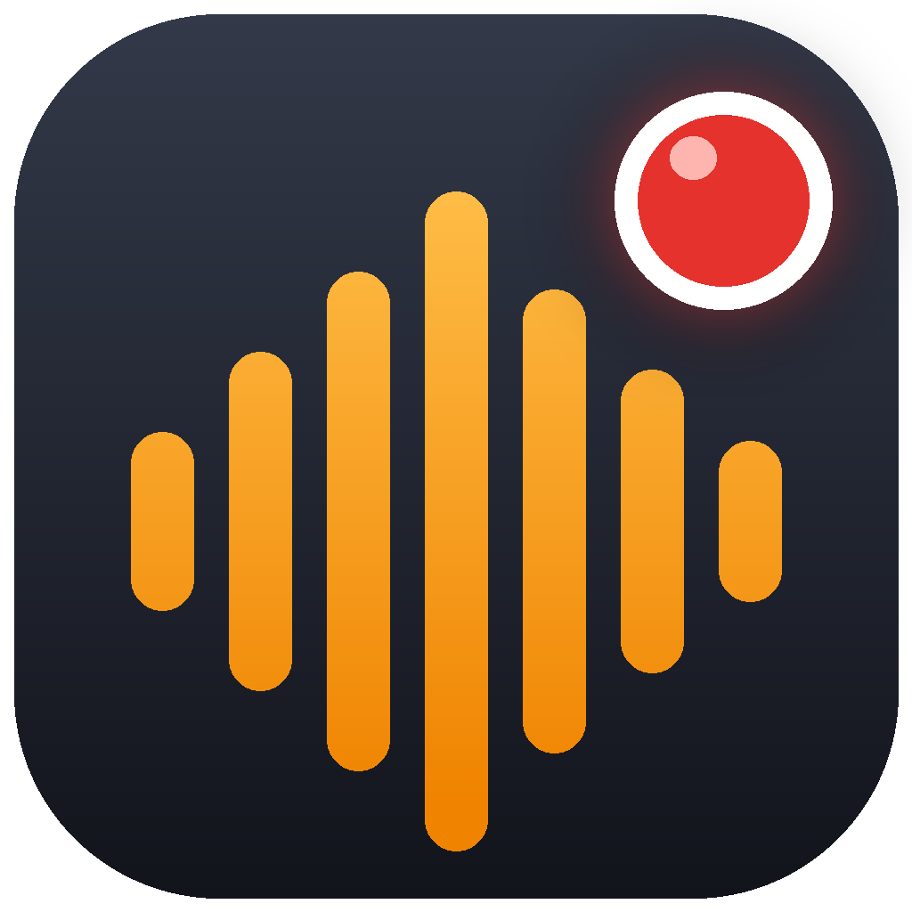

# Audible Recorder

A small Windows app that records the audio of **one chosen application** (for example the
Audible Cloud Player running in a browser) to an **Opus** file, using WASAPI process loopback.
Plain Win32 interface, statically linked: nothing to install and no extra DLLs.

> For personal use with content you are entitled to listen to. Respect the terms of service
> of the services you use and applicable copyright law.

## Requirements
Windows 10 version 2004 (build 19041) or newer, 64-bit.

## If Windows shows a warning
New or little-downloaded apps can trigger the blue "Windows protected your PC" (SmartScreen) screen.
The app is open source and you can read or build it yourself. To run it:

**Option 1: at launch**
1. On the blue screen, click **More info**.
2. Click **Run anyway**.

**Option 2: unblock the file first**
1. Right-click the downloaded `AudibleRecorder.exe` and choose **Properties**.
2. At the bottom of the **General** tab, tick **Unblock** (next to "Security").
3. Click **OK**, then run the file as usual.

## Use
Chrome plays the audio of **all** its tabs through one shared audio process, so recording
"Chrome" always includes every tab. To record only Audible:

1. Click **Open Audible in separate browser**. It starts Chrome (or Edge) with its own profile,
   which is a separate process tree. Sign in once, play Audible there, and keep other browsing
   (YouTube etc.) in your normal browser.
2. Press **Refresh**. The **Record from** list shows windows titled "Audible Cloud Player" and
   processes currently playing audio, each with its PID.
3. Pick the entry that starts with **Isolated - safe**, press **Record**, then **Stop**.

If you pick a regular browser instance, the app warns that all its tabs/windows are recorded.
Recording stops (and the file is finalised) automatically if the target process exits.
Output is Ogg Opus (`.opus`), 48 kHz stereo, bitrate selectable (default 96 kbps).

## Build
Linux / macOS / WSL (mingw-w64 + cmake + curl):

    ./build.sh

This downloads and builds libopus 1.5.2, then produces `AudibleRecorder.exe`.

MSVC: build libopus statically with `/MT`
(`cmake -DCMAKE_MSVC_RUNTIME_LIBRARY=MultiThreaded -DBUILD_SHARED_LIBS=OFF ...`), then

    rc app.rc
    cl /O2 /MT /EHsc /I<opus>\include main.cpp opus.lib app.res user32.lib gdi32.lib comdlg32.lib ole32.lib /link /SUBSYSTEM:WINDOWS

## Code signing policy
Free code signing provided by [SignPath.io](https://signpath.io), certificate by [SignPath Foundation](https://signpath.org).

- Only `AudibleRecorder.exe` files built by this repository's GitHub Actions workflow
  (`.github/workflows/build.yml`) from the source in this repository are signed.
- Roles: author, reviewer and approver: [dubnikov](https://github.com/dubnikov).

## Privacy
This program will not transfer any information to other networked systems unless specifically
requested by the user or the person installing or operating it. Recordings are written only to the
file you choose. (The "Open Audible in separate browser" button just starts your browser.)

## Licenses
This project is released under the MIT License (see `LICENSE`).
Includes [libopus](https://opus-codec.org/) (BSD 3-clause), see `licenses/opus-COPYING.txt`.
